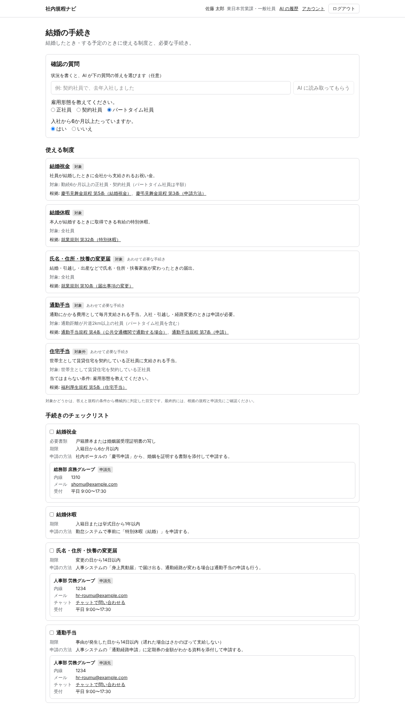
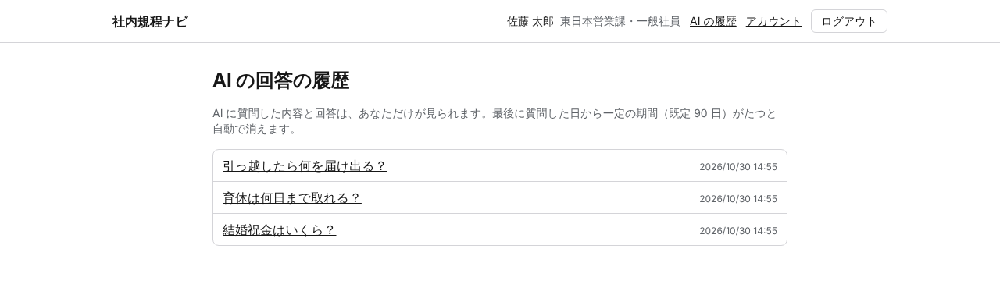
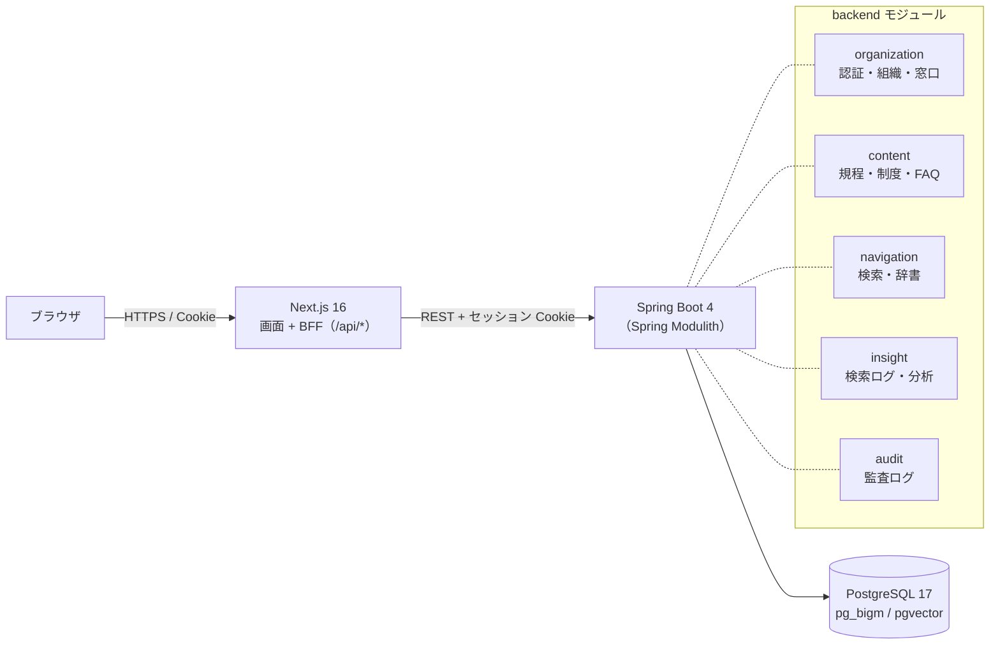

# 社内規程ナビ（Knowledge Navigator）

> 「何を調べればいいかわからない」を、「誰に・何を・どこで」まで案内する。

社内規程・福利厚生・手順書・FAQ・組織情報を横断し、**自然言語の質問**から
**使える制度 / 根拠となる規程の条文 / よくある質問 / 問い合わせ先** をまとめて案内するナビゲーションシステムです。

> ⚠️ 本リポジトリのデータはすべて架空企業「架空商事株式会社」のダミーデータです。実在の企業・規程・人物とは関係ありません。


## できること

| 利用者 | 機能 |
|---|---|
| 社員 | 「結婚したら何か制度ある？」「PC壊れた」のような言い方で検索し、**制度・規程・FAQ・窓口の4ブロック**で案内を受ける。制度名を知らなくても、きっかけ（結婚・出産・引越し・介護など）から探せる |
| 社員 | 制度の詳細（対象者・金額・期限・申請方法・根拠の条文・窓口）、規程の全文（目次・条文へのリンク・検索語の強調・過去の版）、FAQ を読む。PDF から取り込んだ規程は、**原本の該当ページ**まで開ける |
| 社員 | 略語・言い換え・表記ゆれ（「育休」「マイカー通勤」「引越／引っ越し」「振り込まれる」）でも見つかる。検索欄で制度名・きっかけの**入力補完**、制度の詳細で「**この制度を見た人はこちらも**」 |
| 社員 | 検索結果の「AI に根拠付きで答えてもらう」から、検索結果の条文をもとに AI が短い答えを書き、**根拠の条（番号付き・条文へのリンク）と窓口**を添える。規程に書かれていないことには答えず、窓口を案内する（`make up-ai` で起動したとき） |
| 社員 | きっかけ（結婚など）の**案内**で、確認の質問（雇用形態・勤続）に答えると、使える制度を「対象・要確認・対象外」に分け、**手続きのチェックリスト**（必要書類・期限・申請先）を出す。判定は AI を使わず DB の条件で行う。状況を書くと AI が質問の答えを選ぶ（本人が確かめてから判定。`make up-ai` で起動したとき） |
| 社員 | AI に質問した内容と回答の**履歴**を見る・消す（本人だけが見られ、90 日で自動で消える） |
| 社員 | 規程の一覧をタグ（対象者・話題）で、よくある質問の一覧をカテゴリで絞り込む |
| 社員 | 部署ごとの問い合わせ先の一覧から窓口を探す。検索結果が役に立ったかを送る（検索の改善に使う）。自分のパスワードを変える |
| コンテンツ担当者 | 自部署が所管する規程（版の作成・改定・公開）・制度（根拠の条・窓口）・FAQ と、きっかけを画面から作成・編集・公開する。**規程の PDF を取り込む**と、条ごと・原本のページ付きの下書きの版ができる |
| コンテンツ担当者 | キーワード辞書（「入籍」→ きっかけ「結婚」など）と**類義語辞書**（「育休」=「育児休業」など）を編集する。何も見つからなかった質問から、そのまま類義語・FAQ を登録する。よく検索される質問・フィードバックを見て改善する |
| システム管理者 | 部署・窓口・ユーザー（ロール・所属・有効/無効）を管理する。監査ログ（誰が・いつ・何を変更したか）を確認する |

**見えてはいけないものは見せない**: 規程・制度・FAQ には公開範囲（社内公開・管理職限定・部署限定・機密）があり、一覧・詳細・関連・検索のすべてで、利用者が見てよいものだけを SQL の段階で絞り込みます（[ADR-0004](docs/adr/0004-permission-prefilter.md)）。件数や抜粋から存在が漏れないことを、ロール × 公開範囲 × 経路のテストで確かめています。

<table>
<tr>
<td></td>
<td></td>
</tr>
<tr>
<td valign="top"></td>
<td valign="top"></td>
</tr>
<tr>
<td></td>
<td></td>
</tr>
</table>

## ローカルで動かす

[](https://codespaces.new/Mika777v/knowledge-navigator?quickstart=1)

GitHub Codespaces でもそのまま動きます（上のボタンから開き、ターミナルで `make up` → `make seed`。4コアを推奨）。準備・確認の順番・困ったときの対処は [動かして確かめる手順](docs/LOCAL_SETUP.md) を参照してください。

必要なもの: Docker（Compose v2）、make。`make test` には Java 21 と Node.js 22 + pnpm、`make eval` には Python 3 と PyYAML も必要です。

```bash
make up      # .env が無ければ .env.example から作成し、ビルドして起動
make up-ai   # 意味検索も使う（ai-service・Ollama も起動。初回は bge-m3 の取り寄せに数分）
make seed    # ダミーデータを投入（デモユーザーでログインできるようになる）
make eval    # 検索品質の評価（評価用質問100問）
make test    # テスト（backend・frontend）
make down    # 停止（データは残る）
make clean   # 停止してデータも削除
make help    # コマンド一覧
```

http://localhost:3000 を開き、下のデモユーザーでログインします。パスワードは `.env` の `DEMO_USER_PASSWORD`（`.env.example` の既定値は `demo-pass-2026`）で、全員共通です。

| メールアドレス | 名前 | 所属 | ロール | 想定 |
|---|---|---|---|---|
| `sato@example.com` | 佐藤 太郎 | 東日本営業課 | 一般社員 | 入社3年目・結婚予定 |
| `suzuki@example.com` | 鈴木 美咲 | 開発第一課 | 一般社員 | 新入社員（入社1か月） |
| `yamamoto@example.com` | 山本 さくら | 西日本営業課 | 一般社員 | 契約社員（制度の対象者の違いを確認する） |
| `tanaka@example.com` | 田中 健一 | 営業部 | 管理職 | 管理職向けの FAQ が見える |
| `takahashi@example.com` | 高橋 由美 | 人事部 | コンテンツ担当者 | 人事の規程・制度・FAQ を管理 |
| `ito@example.com` | 伊藤 誠 | 総務部 | コンテンツ担当者 | 慶弔・社内ルールを管理 |
| `kobayashi@example.com` | 小林 修 | 法務・コンプライアンス部 | コンテンツ担当者 | ハラスメント防止規程を管理 |
| `kato@example.com` | 加藤 直樹 | 情報システム部 | コンテンツ担当者 | 情報セキュリティ・PC 貸与規程を管理 |
| `watanabe@example.com` | 渡辺 翔 | 情報システム部 | システム管理者 | 組織・ユーザーの管理と監査ログの確認（職務分離のためコンテンツは編集できない） |

| サービス | URL |
|---|---|
| frontend | http://localhost:3000 |
| backend | http://localhost:8080/actuator/health 、API 仕様 http://localhost:8080/swagger-ui.html |
| PostgreSQL | localhost:5432（pg_bigm / pgvector 入り） |
| ストレージ（S3 互換・SeaweedFS） | localhost:8333（アップロードした PDF の原本） |

## 構成



- **検索**: 質問の整理（口語の除去・語の抽出）→ キーワード辞書（最長一致）→ pg_bigm の全文検索 → スコアの統合 → 窓口の導出（必ず1件以上）。詳しくは [ARCHITECTURE.md §4](docs/ARCHITECTURE.md)
- **認可**: `AccessPolicy` に集約し、すべての読み取りを SQL の WHERE 句で絞り込む（プレフィルタ）
- **ログイン**: セッション Cookie + CSRF トークン。同じアカウントで続けて失敗すると一時的にロックする。ロールの変更・無効化・異動は、ログイン中のセッションにも次のリクエストで反映する
- **検索ログ**: ユーザー ID は HMAC で仮名化。分析では2人以上が検索した質問だけを集計し、保存期間（既定180日）を過ぎたら自動で削除する

## 品質

評価用質問100問（[data/eval](data/eval/)）で、PR ごとに CI で検索品質を測り、基準値との比較を PR にコメントします。目標（Hit@5 85%。v0.3.0 の目標）を下回ると CI が失敗します。重みは `make eval-tune` のグリッド探索で決めています。

> 外れた質問を見てから辞書を直したもの（2問）を含むため、初めて見る質問での実力より高めに出ています。

| 指標 | 現在の値 |
|---|---|
| Hit@1（1位に正解） | 91% |
| Hit@5（上位5件に正解） | 100% |
| MRR | 0.95 |
| 窓口正答率 | 100% |
| ゼロヒット率 | 0% |

根拠付きの回答は、評価用質問42問を `eval-rag`（GitHub Actions の手動実行、または `make eval-rag`）で測ります。

| 指標（42問） | 現在の値 |
|---|---|
| 引用の正確さ | 97.2%（目標 95%） |
| 要点の正答率 | 86.1% |
| 回答率 | 94.7% |
| 回答不能の適切さ | 100% |

- backend: JUnit + Testcontainers（実際の PostgreSQL + pg_bigm）、Spring Modulith のモジュール境界テスト、権限マトリクステスト
- frontend: Vitest + Testing Library、E2E は Playwright（`make up` した環境をブラウザで操作し、CI でも実行）
- セキュリティ: CSRF 対策、CSP などのセキュリティヘッダー、Markdown は HTML を描画しない、監査ログは追記専用（DB のトリガーで更新・削除を拒否）、CodeQL によるスキャン

## 技術スタック

| 層 | 技術 |
|---|---|
| frontend | Next.js 16（App Router）/ React 19 / Tailwind CSS 4 / TanStack Query / openapi-typescript |
| backend | Spring Boot 4 / Java 21 / Spring Modulith / Spring Security / Flyway |
| DB | PostgreSQL 17 + pg_bigm（日本語の部分一致検索）+ pgvector（意味検索のベクトル） |
| 検索 | pg_bigm の部分一致 + Sudachi（形態素解析・正規化形）+ キーワード辞書・類義語辞書（[ADR-0002](docs/adr/0002-japanese-search-pg-bigm.md)・[ADR-0011](docs/adr/0011-sudachi-normalized-search.md)）。意味検索と RRF で合わせるハイブリッド検索（[ADR-0007](docs/adr/0007-pgvector.md)） |
| AI | ai-service（FastAPI / Python 3.12 / uv）。Embedding は Ollama の bge-m3（既定）・OpenAI・Azure OpenAI を切り替え。回答文の生成と、書いた状況からの読み取りは Ollama の qwen3.5:4b（既定）。AI の上乗せはサーバの設定 1 つでオン・オフ（[ADR-0006](docs/adr/0006-ai-service-stateless.md)・[ADR-0008](docs/adr/0008-llm-provider-abstraction.md)・[ADR-0013](docs/adr/0013-rag-generation-model-and-delivery.md)・[ADR-0014](docs/adr/0014-assistant-rule-based-hearing-and-history.md)） |
| CI | GitHub Actions（変更に応じて backend・frontend・DB・compose・データ・検索品質を実行。リリースのタグでイメージを ghcr.io に公開） |

## ドキュメント

- [設計ドキュメント一覧・最終まとめ](docs/README.md)
- [Product Vision](docs/PRODUCT_VISION.md) / [PRD](docs/PRD_KNOWLEDGE_NAVIGATOR.md) / [Architecture](docs/ARCHITECTURE.md) / [ADR](docs/adr/)
- [ロードマップ](docs/ROADMAP.md) / [タスク分解](docs/TASKS.md)
- [GitHub 運用ルール](docs/GITHUB_WORKFLOW.md) / [リポジトリ初期設定の手順](docs/REPOSITORY_SETUP.md)
- [デモ環境の AWS 構成](docs/DEMO_AWS.md)
- [ダミーデータ](data/README.md) / [評価用質問](data/eval/README.md)
- [変更履歴](CHANGELOG.md)

## ステータス

[v0.6.0](https://github.com/Mika777v/knowledge-navigator/releases/tag/v0.6.0)（AI アシスタントの試作）をリリースしました。v0.5.0 までの検索・閲覧・管理・PDF の取り込み・意味検索・根拠付きの回答に加え、きっかけから確認の質問に答えて制度と手続きを整理する案内と、AI に質問した内容の履歴があります（[変更履歴](CHANGELOG.md)）。ROADMAP の版はここまでです（[ROADMAP](docs/ROADMAP.md)）。

## ライセンス

コード: [MIT](LICENSE)。ダミーデータ（`data/`）: CC BY 4.0。
