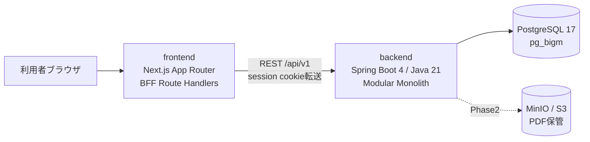
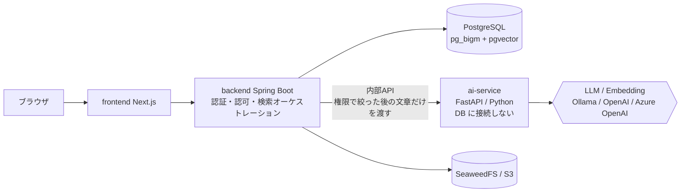
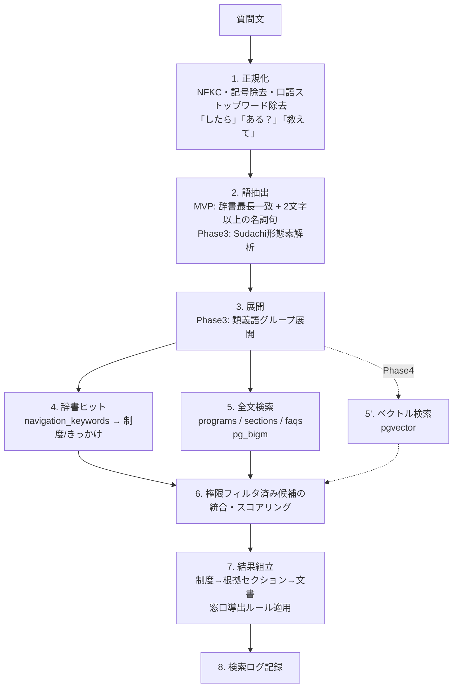
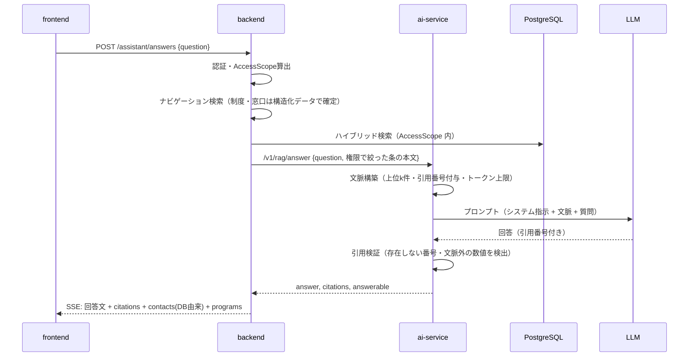

# ARCHITECTURE — 社内規程ナビ

> ステータス: Draft v0.1 / 2026-10-20
> 内容: システム構成 / API設計 / 検索アーキテクチャ / AI導入アーキテクチャ / セキュリティ / ディレクトリ構成

---

## 1. アーキテクチャ方針

| 方針 | 内容 |
|---|---|
| **モジュラーモノリスから始める** | MVPは `frontend` + `backend` + `PostgreSQL` の3コンテナ。境界はパッケージで切り、分割は必要になってから |
| **AIは後付け可能な別サービス** | Phase4で Python の `ai-service` を追加。backend は検索の「オーケストレーター」であり続ける |
| **PostgreSQLに寄せる** | 全文検索（pg_bigm）もベクトル（pgvector）も同一DB。トランザクション整合と権限フィルタを1クエリで実現 |
| **検索エンジンは差し替え可能に** | `SearchPort` インターフェースを切り、規模拡大時に OpenSearch 実装を追加できる |
| **LLMプロバイダは設定で切替** | Ollama（ローカル・外部送信なし）/ OpenAI / Azure OpenAI |
| **スキーマ駆動** | OpenAPI を正とし、フロントの型（TypeScript）を自動生成 |

---

## 2. システム構成

### 2.1 MVP（Phase1-3）



### 2.2 将来（Phase4-6）



**権限は backend だけが判定する**。ai-service は DB に接続せず、backend が権限で絞り込んだ後の文章を受け取って、ベクトルや回答文を計算して返すだけにする（認可ロジックの二重実装を防ぐ。[ADR-0006](./adr/0006-ai-service-stateless.md)）。Embedding のジョブ・ベクトルの保存・ベクトル検索も backend が行い、Python の ingest-worker は置かない。

### 2.3 backend モジュール構成

```
backend/src/main/java/com/example/knavi/
├── shared/           # 共通（ID、時刻、例外、AccessPolicy）
├── organization/     # 部署・窓口・ユーザー
├── content/          # 文書・版・セクション・制度・FAQ・カテゴリ・タグ
├── navigation/       # クエリ解析・辞書・検索・結果組立（SearchPort）
├── ingestion/        # Phase2: ファイル・PDF解析・ジョブ
├── insight/          # 検索ログ・フィードバック・評価
├── audit/            # 監査ログ
└── assistant/        # Phase5: ai-service クライアント、会話
    各モジュール: api/ (Controller, DTO) / application/ (UseCase) / domain/ / infrastructure/ (JPA, jOOQ)
```

モジュール間依存は **Spring Modulith** で検証（循環依存をテストで検出）。

---

## 3. API設計

- ベース: `/api/v1`、JSON、OpenAPI 3.1（`backend` から springdoc で生成し `docs/api/openapi.yaml` にコミット）
- 認証: セッションCookie（HttpOnly, Secure, SameSite=Lax）+ CSRFトークン。将来 OIDC
- エラー: RFC 9457 Problem Details
- ページング: `?page=&size=`（管理画面）、検索は `limit` のみ
- 楽観ロック: 更新系は `If-Match: <row_version>`

### 3.1 利用者向け API

| Method | Path | 説明 | Phase |
|---|---|---|---|
| GET | `/auth/csrf` | CSRF トークンの発行（XSRF-TOKEN Cookie）。ログイン前に呼ぶ | 1 |
| POST | `/auth/login` / `/auth/logout` | ログイン/ログアウト（CSRF トークン必須） | 1 |
| GET | `/me` | ログインユーザー情報・ロール | 1 |
| **GET** | **`/navigate?q=`** | **ナビゲーション検索（制度/文書/セクション/FAQ/窓口の4ブロック）** | 1 |
| GET | `/search/suggest?q=` | サジェスト（入力に一致する制度名・きっかけ。名前の先頭一致 → 途中に含む → キーワードの前方一致の順、最大8件。制度は検索と同じ権限で絞る） | 3 |
| GET | `/life-events` / `/life-events/{code}` | きっかけ一覧/詳細（PRIMARY = まず確認する制度、RELATED = あわせて必要な手続き） | 1 |
| GET | `/programs`（`?category=`）/ `/programs/{id}` | 制度一覧 / 詳細（根拠条文・窓口・関連FAQ・きっかけ。根拠は文書ごとに閲覧範囲で絞る） | 1 |
| GET | `/programs/{id}/recommendations` | 制度の推薦（検索結果からあわせて開いた人が3人以上の制度 → 同じきっかけの制度の順、最大5件。元の制度・推薦する制度とも検索と同じ権限で絞り、元の制度が見えなければ空） | 3 |
| GET | `/documents?category=` | 文書一覧（親カテゴリを指定すると子カテゴリも含む） | 1 |
| GET | `/documents/{id}`（`?version={versionId}` で公開済みの過去の版） | 文書詳細（条文・版の履歴・この文書を根拠にする制度と窓口） | 1 |
| GET | `/sections/{id}` | 条文単体（引用リンク先。過去の版の条文も表示し、公開版かどうかを返す） | 1 |
| GET | `/sections/{id}/similar` | 類似条文 | 4 |
| GET | `/faqs`（`?category=`）/ `/faqs/{id}` | FAQ 一覧 / 詳細（回答・窓口・関連する制度と条文） | 1 |
| GET | `/contacts` | 部署ごとの問い合わせ窓口 | 1 |
| GET | `/categories` | カテゴリツリー | 1 |
| POST | `/search-logs/{id}/clicks` | クリック記録 | 1 |
| POST | `/search-logs/{id}/feedback` | フィードバック | 1 |
| POST | `/assistant/answers` (SSE) | 根拠付き回答生成 | 5 |
| POST | `/assistant/sessions` / `/{id}/messages` | 対話 | 6 |

> 一般利用者向けの API は、すべて `AccessPolicy` の閲覧条件（公開範囲・所属・ロール）で絞り込んだ結果を返す。見えない詳細は 404（存在の有無も分からないようにする）。ADR-0004

### 3.2 管理 API（`/api/v1/admin`）

| Method | Path | ロール |
|---|---|---|
| GET/POST/PUT | `/admin/documents`、`/admin/documents/{id}`（更新は `If-Match` 必須） | EDITOR（所管） |
| GET/POST/PUT | `/admin/documents/{id}/versions`、`/versions/{versionId}`（本文は条単位に自動分割。公開済みの版は更新不可） | EDITOR（所管） |
| POST | `/admin/documents/{id}/publish`（`{versionId}`）、`/admin/documents/{id}/archive`（`If-Match` 必須） | EDITOR（所管） |
| GET/POST/PUT | `/admin/programs`、`/admin/programs/{id}`、`PUT /{id}/basis`（条単位）、`PUT /{id}/contacts`、`POST /{id}/publish`・`/archive`（更新系は `If-Match` 必須） | EDITOR（所管） |
| GET/POST/PUT | `/admin/faqs`、`/admin/faqs/{id}`、`POST /{id}/publish`・`/archive`（更新系は `If-Match` 必須） | EDITOR（所管） |
| GET/POST/PUT | `/admin/life-events`、`/admin/life-events/{code}`（紐づける制度もまとめて置き換え。更新は `If-Match` 必須） | EDITOR（部署を問わない） |
| GET/POST/DELETE | `/admin/navigation-keywords`（`?targetType&targetId` または `?term` で逆引き） | EDITOR / ADMIN |
| CRUD | `/admin/life-events`、`/admin/synonyms`（Phase3） | EDITOR |
| GET/POST/PUT | `/admin/departments`・`/admin/departments/{code}`、`/admin/contacts`・`/{code}`、`/admin/users`・`/{id}`（更新は `If-Match` 必須。パスワードは返さない。自分自身のロール変更・無効化と、最後のシステム管理者を外すことは不可。ロールの変更は次のログインから効く） | ADMIN |
| CRUD | `/admin/categories`、`/admin/tags` | ADMIN（未実装） |
| POST | `/admin/files`（multipart）→ `POST /admin/ingestion-jobs` | EDITOR（Phase2） |
| GET | `/admin/ingestion-jobs/{id}` | EDITOR（Phase2） |
| GET | `/admin/analytics/zero-hits`、`/top-queries`、`/feedback`（`?from=&to=&limit=`。日本時間の日付、既定は30日間。質問ごとの集計は異なる利用者が2人以上のものだけ） | EDITOR/ADMIN |
| GET | `/admin/audit-logs` | ADMIN |
| POST | `/admin/evaluations/run`、GET `/admin/evaluations` | ADMIN |

### 3.3 `GET /api/v1/navigate?q=結婚したら何か制度ある？` レスポンス例

```json
{
  "searchLogId": "0192f1c4-...",
  "query": {
    "raw": "結婚したら何か制度ある？", "normalized": "結婚 制度",
    "terms": ["結婚"], "matchedLifeEvents": [{ "code": "MARRIAGE", "name": "結婚" }]
  },
  "programs": [
    {
      "id": "...", "code": "PRG-MARRIAGE-GIFT", "name": "結婚祝金", "summary": "社員が婚姻したときに支給",
      "benefit": "30,000円（社員同士の結婚はそれぞれに支給）", "deadlineNote": "入籍後6か月以内",
      "basis": [{ "documentId": "...", "documentTitle": "慶弔見舞金規程", "versionLabel": "v2.1", "sectionId": "...", "articleNo": "第5条" }],
      "score": 13.5, "reasons": ["LIFE_EVENT:結婚", "KEYWORD:結婚", "TEXT:結婚"]
    },
    { "id": "...", "code": "PRG-MARRIAGE-LEAVE", "name": "結婚休暇", "basis": [{ "documentTitle": "就業規則", "articleNo": "第32条" }], "score": 10.5, "reasons": ["..."] }
  ],
  "documents": [
    {
      "id": "...", "code": "REG-GA-001", "title": "慶弔見舞金規程", "versionLabel": "v2.1", "effectiveFrom": "2026-04-01",
      "sections": [{ "id": "...", "articleNo": "第5条", "heading": "結婚祝金", "snippet": "社員が婚姻したときは、結婚祝金として…" }],
      "score": 6.75
    }
  ],
  "faqs": [{ "id": "...", "code": "FAQ-001", "question": "入籍前に結婚祝金を申請できますか？", "score": 4.1 }],
  "contacts": [
    { "id": "...", "code": "GA-GENERAL", "name": "総務部 庶務グループ", "department": "総務部", "phoneExt": "1310", "email": "...", "chatUrl": null, "officeHours": "平日 9:00-17:30", "reason": "結婚祝金の申請窓口" },
    { "id": "...", "code": "HR-LABOR", "name": "人事部 労務グループ", "department": "人事部", "reason": "結婚休暇の問い合わせ先" }
  ],
  "relatedPrograms": [{ "id": "...", "code": "PRG-PERSONAL-INFO-CHANGE", "name": "氏名・住所・扶養の変更届" }],
  "fallback": false
}
```

- **snippet はプレーンテキスト**（HTML を含まない）。強調は画面側で `query.terms` を使って付ける（条文の内容による HTML 埋め込みを防ぐため）。
- `reasons` は表示理由: `LIFE_EVENT:<きっかけ>` / `KEYWORD:<辞書の語>` / `TEXT:<本文で一致した語>` / `BASIS:<制度の根拠の文書>` / `PROGRAM_FAQ`（上位の制度に紐づく FAQ）。
- 窓口は **必ず1件以上**: 上位3件の制度の窓口 → 辞書で見つかった窓口 → FAQ の窓口 の順に最大4件。1件もなければ総合窓口（`app_settings.navigation.default_contact_code`）。`fallback` は制度・文書・FAQ がどれも見つからなかったとき `true`。
- `searchLogId` は検索ログの ID。結果のクリックは `POST /search-logs/{id}/clicks`（`{targetType, targetId, rank}`）、役に立ったかは `POST /search-logs/{id}/feedback`（`{helpful, comment}`、押し直しは上書き）で記録する。**検索した本人だけが記録でき**、他人の検索ログの ID は 404。ログの記録に失敗しても検索結果は返す（そのときは `null`）。
- 検索ログのユーザーは `HMAC-SHA256(user_id)` で仮名化して保存する（鍵は `KNAVI_USER_HASH_SECRET`）。鍵がなければログから個人の検索履歴は分からないが、同じ人の検索は同じ値になるため利用者数の集計と本人確認に使える。

---

## 4. 検索アーキテクチャ

### 4.1 日本語検索の前提（重要）

PostgreSQL 標準の Full Text Search（`to_tsvector`）は **日本語の分かち書きを行わない**ため、そのままでは日本語検索に使えない。選択肢:

| 方式 | 内容 | 採用 |
|---|---|---|
| **pg_bigm** | 2-gram の GIN インデックスで `LIKE '%結婚%'` を高速化、`bigm_similarity` でスコア | **MVP採用**（導入が簡単、取りこぼしが少ない） |
| アプリ側形態素解析 + tsvector | Sudachi（Java版 / Python版）で分かち書き・正規化形を `simple` 構成の tsvector に格納 | **Phase3で併用**（表記ゆれ・ランキング改善） |
| PGroonga | 高機能な日本語全文検索 | 代替案（マネージドDBでの提供状況に依存） |
| OpenSearch + kuromoji/sudachi | 本格的な検索エンジン | 規模拡大時の移行先 |

> pg_bigm は公式 postgres イメージに含まれないため、独自 Dockerfile でビルドする。マネージドDB（RDS / Cloud SQL / Azure）での利用可否は採用前に要確認。

### 4.2 ナビゲーション検索パイプライン



**権限フィルタは 5 の SQL 内で適用する**（`visibility` 条件 + `access_rules` の EXISTS）。

### 4.3 スコアリング（MVP）

```
score(item) = Σ  w_source × match_strength
  w_source:  辞書(きっかけ/制度直撃)=3.0, 制度名一致=2.5, FAQ質問一致=2.0,
             見出し一致=1.5, 本文一致=1.0
  match_strength: bigm_similarity または 完全一致=1.0
  + 鮮度ボーナス（直近改定）、Phase3でクリック率を加味
```

- 重みは設定ファイル化し（`application.yaml` の `knavi.navigation.weights`）、**評価用質問セットで A/B 比較**して決める。
- 辞書の照合は**最長一致**（「結婚式」に一致したら、それに含まれる「結婚」は使わない）。語がそのまま含まれないときは**語幹**でも照合する（「名詞＋を/が/に/は＋ひらがな」は助詞の前まで、それ以外は末尾の活用語尾を除く。例: 眠れない → 眠れ、出勤時間をずらす → 出勤時間）。語幹での一致は `keyword-stem`（0.7）を掛けて弱める。文書のスコアは条ごとに足さず、最も強く一致した条のスコアを使う（条の多い文書が有利にならないように）。
- **表記ゆれ・活用のちがい**（ADR-0011）: 制度・条・FAQ は `search_text`（原文の正規化）に加えて `search_norm`（Sudachi の正規化形を空白で区切ったもの。振り込まれますか → 振り込む れる ます か）を持ち、語はどちらかに含まれれば一致とみなす。質問からは、正規表現で取り出す語に加えて、名詞のまとまり（満員 電車）と動詞・形容詞の正規化形（振り込む・抜ける）を語にする。辞書の照合で一致した部分からは取り出さない（「子どもが生まれる」の中の「子供」で、関係の薄い制度を強めないように）。「する」「使う」などの動詞、「手当」「制度」などの名詞は、単独では語にしない。辞書がなければ `search_text` だけで検索する。
- **類義語辞書**（`synonym_groups` / `synonym_terms`、管理は `/admin/synonyms`）: 質問にグループの語が含まれていれば、同じグループのほかの語でも探す（最長一致。「育休明け」に一致したら「育休」は使わない）。辞書の照合は一致した語を類義語に置き換えた質問で行い、全文検索には類義語そのものと、質問の語の一部を置き換えた語（マイカー通勤 → 車で通勤）を足す（最大6語）。広げた語での一致は `synonym`（0.8）を掛けて弱め、質問そのもので一致した案内先は二重に強めない。
- 1位のスコアの 20%（`min-relative-score`）未満の制度は出さない。
- 制度がヒットしたら、その根拠セクション・文書を自動的に結果に含める（「制度経由の文書」）。

### 4.4 検索品質評価

```yaml
# data/eval/questions.yaml
- q: 結婚したら何か制度ある？
  expect:
    programs: [PRG-MARRIAGE-GIFT, PRG-MARRIAGE-LEAVE]
    contacts: [HR-LABOR]
- q: PC壊れた
  expect:
    contacts: [IT-HELPDESK]
    documents: [REG-IT-002]
```

- 指標: Hit@1, Hit@5, MRR, 窓口正答率, ゼロヒット率
- GitHub Actions で PR ごとに実行し、**前回 main 比で悪化したら警告コメント**

### 4.5 検索エンジン差し替え

```java
public interface SearchPort {
  SearchCandidates search(NormalizedQuery q, AccessScope scope, int limit);
}
// 実装: PgBigmSearchAdapter (MVP) / HybridSearchAdapter (Phase4) / OpenSearchAdapter (将来)
```

**OpenSearch への移行判断基準**: セクション数 100万超、または複数言語・高度な分析（ファセット集計・ハイライト高度化）が必要になった時点。それまでは PostgreSQL 一本の方が運用・権限整合の面で有利。

---

## 5. AI導入アーキテクチャ

### 5.1 段階的導入

| Phase | AIの役割 | 失敗時の挙動 |
|---|---|---|
| 1-3 | なし | — |
| 4 | Embedding による意味検索（言い換え吸収） | ベクトル検索を無効化しキーワード検索のみで動作 |
| 5 | 検索結果を文脈にした回答文生成（RAG） | 回答文を出さず、Phase1の4ブロック結果のみ表示 |
| 6 | 確認質問・制度網羅・チェックリスト化 | 通常検索にフォールバック |

**AIは常に「上乗せ」であり、AI停止時もナビゲーションは機能する**（Graceful Degradation）。

### 5.2 Embedding / インデックス

| 項目 | 方針 |
|---|---|
| 単位 | セクション（条単位）。長い条は 600〜800字で分割、前後 100字オーバーラップ。見出しパス（文書名 > 章 > 条）を先頭に付与 |
| 対象 | `INTERNAL`/`MANAGERS`/`RESTRICTED` の公開済み最新版、FAQ、制度。**CONFIDENTIAL は対象外** |
| モデル | ローカル: `bge-m3`（Ollama, 1024次元, 多言語） / クラウド: `text-embedding-3-small`（OpenAI / Azure OpenAI） |
| 更新 | 版公開イベント → ジョブキュー（PostgreSQL の `SELECT ... FOR UPDATE SKIP LOCKED`）→ backend のワーカーが差分計算（`content_hash`）し、変わったものだけ ai-service でベクトルにして保存（[ADR-0006](./adr/0006-ai-service-stateless.md)） |
| 再計算 | モデル変更時は新モデルで並行生成 → 評価 → 切替（Blue/Green） |

### 5.3 ハイブリッド検索

```
keyword_hits  = pg_bigm 上位50件（権限フィルタ済）
vector_hits   = pgvector 上位50件（同じ権限フィルタを WHERE 句で）
fused         = RRF(k=60)  : score = Σ 1 / (k + rank_i)
reranked      = (Phase5オプション) Cross-Encoder rerank（bge-reranker 系）
```

- **段階的に入れる**: ベクトル検索は設定（例: `knavi.search.vector.enabled`）でオン・オフでき、オフなら今のキーワード検索だけで動く（§5.1 の Graceful Degradation）。評価用の質問で、オン・オフの成績を比べてからオンにする。設定の名前・既定値・判定する場所・トグルを消す時期は [ADR-0007](./adr/0007-pgvector.md) で決めた（`knavi.search.vector.enabled`、既定 `false`、navigation モジュールで判定、トグルは消さない）

### 5.4 RAG フロー



### 5.5 ハルシネーション対策（必須要件の担保）

| 対策 | 内容 |
|---|---|
| **窓口・根拠はLLMに生成させない** | 問い合わせ先は `program_contacts` 等のDB値。根拠表示は検索で得たセクションIDから描画 |
| 引用必須プロンプト | 「文脈に無いことは答えない」「各文に [n] を付ける」「金額・日数・期限は原文から引用」 |
| 引用検証 | 回答中の [n] が文脈に存在するか、数値が引用元に含まれるかを機械チェック。失敗時は回答文を破棄して通常結果を表示 |
| 回答不能判定 | 検索スコアが閾値未満 / LLMが「不明」と判断 → 「規程上の記載が見つかりません。人事部 労務グループへお問い合わせください」 |
| 免責表示 | 「AIによる要約です。最終判断は根拠文書と担当部署へ」 |
| プロンプトインジェクション | 文書内の命令文は「データ」として区切り文字で囲う。文書登録者は社内EDITORに限定 |

### 5.6 LLM プロバイダ抽象化

```python
# ai-service/app/llm/base.py
class ChatModel(Protocol):
    async def stream(self, messages: list[Message], **opts) -> AsyncIterator[str]: ...
class EmbeddingModel(Protocol):
    async def embed(self, texts: list[str]) -> list[list[float]]: ...
# 実装: OllamaChat / OpenAIChat / AzureOpenAIChat  ← 環境変数 LLM_PROVIDER で切替
```

- デフォルトは **Ollama（ローカル）**: ダミーデータでも「外部送信ゼロで動く」構成を示せる
- 実務想定は **Azure OpenAI**: 閉域接続（Private Endpoint）、データ所在地、エンタープライズ契約
- LangChain 等のフレームワークへの全面依存は避け、薄い自前抽象 + 必要部分のみライブラリ利用（バージョン追随コストの抑制）

### 5.7 RAG 評価

- 評価セット: 質問 / 期待根拠セクション / 期待される要点（数値・期限）
- 指標: 検索 Recall@k、引用正確性（引用先に主張が含まれるか）、回答忠実性（LLM-as-a-judge + 人手サンプリング）、回答不能の適切性
- CIでは小さなローカルモデルで「引用検証ロジック」まで回し、フル評価は手動ワークフロー（`workflow_dispatch`）

---

## 6. セキュリティ設計

| 領域 | 設計 |
|---|---|
| 認証 | MVP: Spring Security フォームログイン + BCrypt、デモユーザー。将来: OIDC（Keycloak を compose で提供 → 実務では Entra ID） |
| セッション | HttpOnly/Secure/SameSite=Lax Cookie、CSRFトークン、アイドル30分 |
| ログイン試行 | 同じメールアドレスで15分以内に5回失敗したら15分ロック（429 + `Retry-After`）。存在しないアカウントも同じく数え、応答からアカウントの有無を分からなくする。送信元 IP では数えない（BFF 経由のため）。状態は backend のメモリ（複数台にするときは共有ストアへ）。`knavi.auth.login.*` で変更可 |
| 認可 | `AccessPolicy` に集約。URLベース（ロール）+ データベース（所管部署・公開範囲）の二層 |
| 検索時認可 | **プレフィルタ**（SQL WHERE）。件数・スニペット・サジェスト・類似検索・RAG文脈すべて同じスコープを使用 |
| 入力 | Bean Validation、Markdown は sanitize（DOMPurify / OWASP HTML Sanitizer）してから描画 |
| ファイル | MIME/拡張子/マジックバイト検証、サイズ上限、ウイルススキャン（ClamAV）フック、署名付きURLで配信 |
| 秘密情報 | `.env` は git 管理外、`.env.example` のみコミット。GitHub は Secret scanning / Push protection 有効化 |
| 依存関係 | Dependabot（Actions・Gradle・npm・Docker）、CodeQL（Java・TypeScript、`security-extended`、PR と毎週）、Secret scanning / Push protection（有効化済み）。Trivy（コンテナイメージ）は、Action をコミット SHA で固定して導入する予定 |
| ログ | 検索ログはユーザーIDをHMACで仮名化。保存期間（既定180日、`knavi.insight.retention-days`）を過ぎた検索ログは毎日 3:17（日本時間）に削除し、クリック・フィードバックも一緒に消える。チャット本文は保持期間後に削除 |
| 監査 | 公開・改定・権限変更・機密文書閲覧を `audit_logs` に追記専用で記録 |
| LLM送信 | プロバイダごとに「外部送信可能な公開範囲」を設定（例: OpenAI は INTERNAL のみ、Ollama は全て） |
| ヘッダ | CSP（ナンスなし。スクリプト・接続先・フォーム送信先を自オリジンに限定、`frame-ancestors 'none'`）、X-Content-Type-Options、X-Frame-Options、Referrer-Policy、Permissions-Policy、HSTS（HTTPS 公開時に `HTTPS_ONLY=true` でビルド）。設定は `frontend/src/lib/security-headers.ts`。ナンス方式は全ページの動的描画が必要で PPR と両立しないため採用しない |

---

## 7. デプロイ構成

| 環境 | 構成 |
|---|---|
| ローカル | `docker compose up`（frontend / backend / postgres / minio / ollama[profile: ai]） |
| CI | GitHub Actions（Testcontainers で PostgreSQL 実起動、評価セット実行） |
| デモ公開 | 単一VM or コンテナPaaS（例: Fly.io / Render / Azure Container Apps）+ マネージドPostgreSQL。デモはダミーデータのみ、ログイン画面にデモアカウント表示 |
| 実務想定 | Azure: Container Apps + Azure Database for PostgreSQL + Blob Storage + Azure OpenAI + Entra ID、Private Endpoint |

IaC は Phase4 以降に `infra/terraform/` で用意（MVPでは compose のみ）。

---

## 8. ディレクトリ構成

### 8.1 MVP時点

```
knowledge-navigator/
├── README.md                    # 概要・スクショ・起動方法・アーキテクチャ図
├── LICENSE                      # MIT（ダミーデータは CC BY 4.0 と明記）
├── compose.yaml
├── .env.example
├── Makefile                     # make up / make seed / make test / make eval
├── docs/
│   ├── PRODUCT_VISION.md  PRD_KNOWLEDGE_NAVIGATOR.md  DOMAIN_MODEL.md
│   ├── ARCHITECTURE.md  TECH_STACK_COMPARISON.md  TECH_STACK_DECISION.md
│   ├── GITHUB_WORKFLOW.md  ROADMAP.md  TASKS.md  DESIGN_REVIEW.md
│   ├── adr/                     # 0001-use-postgresql-pg_bigm.md ...
│   ├── api/openapi.yaml
│   └── images/
├── backend/                     # Spring Boot（Gradle Kotlin DSL）
│   ├── build.gradle.kts
│   └── src/{main,test}/...
│       └── resources/db/migration/   # Flyway V1__init.sql ...
├── frontend/                    # Next.js + TypeScript
│   ├── src/app/  src/components/  src/lib/api/ (OpenAPI生成型)
│   └── package.json
├── data/
│   ├── seed/                    # departments.yaml, documents/*.md, programs.yaml, faqs.yaml ...
│   └── eval/questions.yaml
├── infra/
│   └── docker/postgres/Dockerfile   # pgvector + pg_bigm
└── .github/
    ├── workflows/ (ci-backend.yml, ci-frontend.yml, eval.yml)
    ├── ISSUE_TEMPLATE/  pull_request_template.md
    ├── CODEOWNERS  dependabot.yml
```

### 8.2 将来拡張時点（Phase4-6）

```
knowledge-navigator/
├── backend/
├── frontend/
├── ai-service/                  # FastAPI（uv管理）
│   ├── app/{api,llm,rag,eval}/   # DB に接続しない（ADR-0006）
│   ├── tests/
│   └── pyproject.toml
├── packages/
│   └── api-client/              # OpenAPI生成クライアント（TS）
├── data/
│   ├── seed/  sample-pdfs/      # ダミー規程PDF（Markdownから生成）
│   └── eval/{search,rag}/
├── infra/
│   ├── docker/
│   ├── terraform/{azure,aws}/
│   └── k8s/ (任意)
├── scripts/                     # seed生成、PDF生成、評価レポート
├── docs/ (adr, runbooks/, eval-reports/)
└── .github/
```
