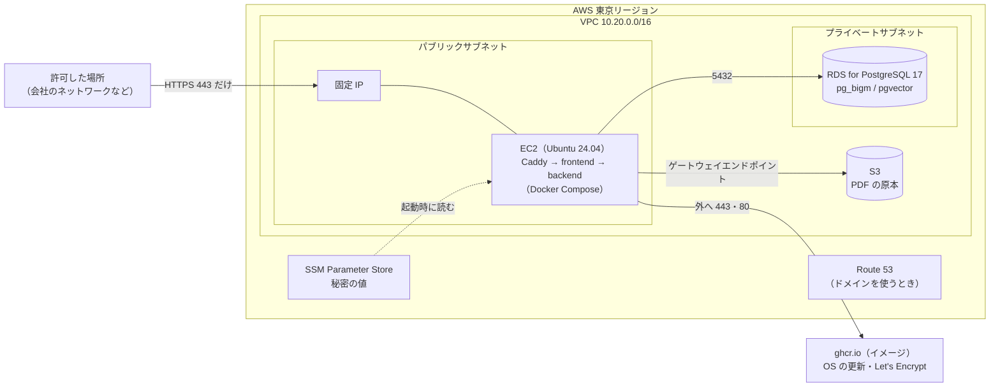

# デモ環境の AWS 構成

デモ環境を AWS に置くときの構成と、作り方・止め方・消し方をまとめる。なぜこの形にしたかは [ADR-0015](adr/0015-demo-environment-on-aws.md)。

> 公開するかどうか・いつ公開するかは未定。このページの手順を実行するまで、AWS には何も作られず、費用もかからない。

## Terraform とは

AWS の資源（サーバ・DB・ネットワークなど）を、画面でひとつずつ作る代わりに、**ファイルに書いておいてコマンドで作る・消す**道具。ファイルは `.tf` という Terraform 専用の書き方で、[`infra/terraform/demo/`](../infra/terraform/demo/) にある。

- `terraform plan`: 何を作る・変える・消すかを表示するだけ（AWS は変わらない）
- `terraform apply`: 実際に作る・変える（確認で `yes` と打つまで何もしない）
- `terraform destroy`: このファイルで作ったものをすべて消す（費用が止まる）

## 構成図



- **外から入れるのは「許可した IP からの 443（HTTPS）」だけ。** SSH（22）・80 は開けない。サーバの操作は AWS の画面の Session Manager から行う
- **NAT ゲートウェイは置かない。** EC2 はパブリックサブネットにあるので自分で外へ出られ、RDS は外へ出る必要がない（NAT は置くだけで東京で月 45 ドルほどかかる）
- AI（ai-service・Ollama）は動かさない。キーワード検索・閲覧・案内・管理画面が動く

## ファイルと資源

| ファイル | 作るもの |
|---|---|
| `versions.tf` | Terraform と AWS プロバイダ（AWS を操作する部品）の版、リージョン、全資源に付けるタグ |
| `variables.tf` | 外から渡す値（許可する IP・ドメイン・サーバの大きさ・予算） |
| `network.tf` | VPC・サブネット（パブリック1つ・プライベート2つ）・インターネットゲートウェイ・経路表・S3 のゲートウェイエンドポイント |
| `security.tf` | セキュリティグループ（通信の許可リスト）。EC2 は許可した IP からの 443 だけ、RDS は EC2 からの 5432 だけ |
| `database.tf` | RDS for PostgreSQL 17（db.t4g.micro、シングル AZ、暗号化、バックアップ 7 日） |
| `storage.tf` | S3 のバケット（公開しない、暗号化） |
| `secrets.tf` | DB のパスワード・検索ログの仮名化の鍵・デモユーザーのパスワードを作り、SSM Parameter Store に置く |
| `compute.tf` | EC2（t3.medium、IMDSv2 だけ、ディスク暗号化）・IAM ロール（このバケットと自分の秘密の値だけ）・固定 IP・ドメインの A レコード |
| `user-data.sh.tftpl` | EC2 を作ったときに一度だけ動く準備（Docker・AWS CLI を入れる） |
| `budget.tf` | 予算の通知（今月の予測が 80% を超えそう・実際に 100% を超えたらメール） |
| `outputs.tf` | 作った後に表示する値（URL・EC2 の ID など） |

CI（`ci-terraform.yml`）が、PR のたびに書式・文法・セキュリティの設定（Trivy）を検査する。AWS には接続しない。

## 費用の目安

動かしている間、次のものに費用がかかる。金額は選ぶ大きさ・使い方で変わるため、作る前に [AWS 料金見積りツール](https://calculator.aws/) で確かめる（このページでは金額を確かめていない）。

| もの | かかり方 |
|---|---|
| EC2（t3.medium） | 動かしている時間。止めている間はかからない |
| EC2 のディスク（30GB）・RDS のディスク（20GB）・バックアップ | 置いている容量。止めていてもかかる |
| RDS（db.t4g.micro） | 動かしている時間。止めている間はかからない（ただし 7 日たつと AWS が自動で起動する） |
| 固定 IP（Elastic IP） | パブリック IPv4 アドレスの時間。止めていてもかかる |
| S3・SSM Parameter Store・通信 | デモの量ならわずか |
| ドメイン（使うとき） | ドメインの年額と Route 53 のホストゾーンの月額 |

使わない期間が長いときは、`terraform destroy` で全部消すのがいちばん安い（データはダミーなので、作り直せば戻る）。

## 作り方（オーナーの PC で行う）

この開発環境（Claude Code）からは AWS に接続できないため、オーナーが行う。

### 1. 準備（一度だけ）

1. **AWS のアカウント**を用意する。ルートユーザー（登録したメールアドレス）では作業せず、IAM Identity Center で作業用のユーザーを作ってログインする
2. **AWS CLI** を入れ、`aws configure sso` で作業用のユーザーでログインできるようにする（`aws sts get-caller-identity` で自分のアカウントの ID が出れば OK）
3. **Terraform**（1.16.6 以上）を入れる（Mac なら `brew install hashicorp/tap/terraform`）
4. 許可する IP を決める。会社のネットワークの出口の IP が固定かどうかは情シスに確かめる（固定でないと、変わったときに入れなくなる）
5. ドメインを使うなら、Route 53 でドメインを取るか、持っているドメインのホストゾーンを用意し、ホストゾーンの ID を控える

### 2. 作る

```bash
cd infra/terraform/demo
cp terraform.tfvars.example terraform.tfvars   # 中を自分の値に書き換える
terraform init                                 # 部品を取り寄せる（初回だけ）
terraform plan                                 # 何が作られるかを確かめる
terraform apply                                # yes と打つと作り始める（RDS で 10 分ほど）
terraform output                               # URL・EC2 の ID などが表示される
```

- `terraform.tfvars` と、作った後にできる `terraform.tfstate`（状態ファイル。**DB のパスワードなどの秘密が入る**）は、リポジトリに入れない（`.gitignore` 済み）。PC の外に出さず、なくさないようにする（なくすと Terraform で消せなくなり、画面から手で消すことになる）

### 3. アプリを起動する

EC2 の上で、公開済みのイメージを使って frontend・backend・Caddy を起動し、ダミーデータを入れる。手順と `compose.demo.yaml` は次の PR で追加する。

## 止める・消す

| したいこと | 方法 |
|---|---|
| しばらく使わない（数日） | AWS の画面で EC2 を「インスタンスを停止」、RDS を「一時的に停止」。起動するときは逆の順番（RDS → EC2） |
| 長く使わない | `terraform destroy`（全部消える。作り直しは `terraform apply` からやり直し） |
| 許可する IP を変える | `terraform.tfvars` の `allowed_cidrs` を直して `terraform apply` |

## 見えてはいけないものを守るしくみ

- 外から届く口は「許可した IP からの 443」だけ。DB・S3 は外から届かない
- EC2 には、この S3 バケットと、このデモの秘密の値（`/knavi-demo/...`）だけを読み書きできる権限を付ける。アクセスキーは作らない
- 秘密の値は Terraform が作って SSM Parameter Store に置き、リポジトリには書かない
- デモのパスワードは全員共通のため、許可した場所の外からは使えない形にしている。誰にでも開ける場合は、ADR-0015 の「見直す条件」を先に満たす
