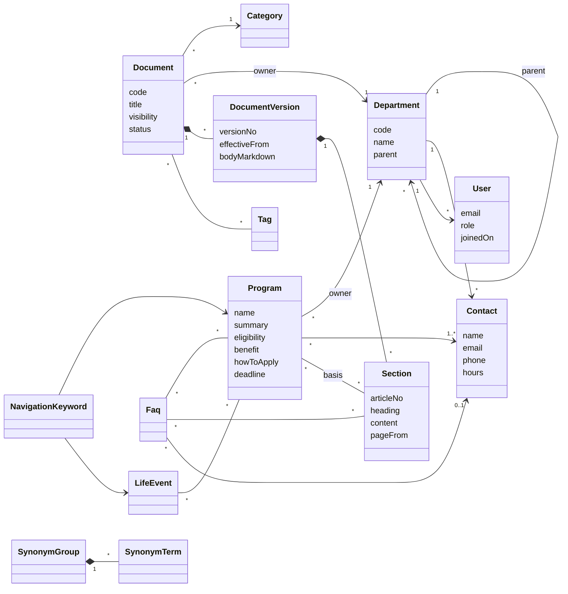

# DOMAIN MODEL — 社内規程ナビ

> ステータス: Draft v0.1 / 2026-10-20
> ドメインモデル / エンティティ設計 / DB設計（PostgreSQL 17 想定）

---

## 1. ドメインの捉え方

本プロダクトの中心は「文書」ではなく **「制度（Program）」と「窓口（Contact）」** である。
文書は制度の **根拠** であり、窓口は制度の **出口** である。

```
  利用者の言葉            ナビゲーション層              知識の実体               出口
 ┌──────────┐      ┌────────────────────┐      ┌──────────────────┐   ┌────────────┐
 │「結婚した」│ ──▶ │ キーワード / 類義語 │ ──▶ │ 制度 Program      │──▶│ 窓口 Contact│
 │            │      │ きっかけ LifeEvent  │      │   └根拠 Section   │   │  └部署      │
 └──────────┘      └────────────────────┘      │ FAQ               │   └────────────┘
                                                 │ 文書 Document     │
                                                 │   └版 Version     │
                                                 │      └Section(条) │
                                                 └──────────────────┘
```

### 1.1 境界づけられたコンテキスト

| コンテキスト | 責務 | 主な集約 |
|---|---|---|
| **Content（ナレッジ管理）** | 文書・版・セクション・制度・FAQ・カテゴリ・タグ | Document, Program, Faq, Category |
| **Organization（組織）** | 部署・窓口・ユーザー | Department, Contact, User |
| **Navigation（検索・案内）** | クエリ解釈、辞書、ランキング、結果組み立て | NavigationKeyword, SynonymGroup, LifeEvent |
| **Ingestion（取込）** Phase2 | ファイル保管、PDF解析、セクション化 | StoredFile, IngestionJob |
| **Intelligence（AI）** Phase4+ | Embedding、ハイブリッド検索、RAG、会話 | Embedding, ChatSession |
| **Insight（分析）** | 検索ログ、フィードバック、評価 | SearchLog, Feedback, EvaluationRun |
| **Access（認可・監査）** | 公開範囲判定、監査 | AccessRule, AuditLog |

MVPでは単一アプリ（モジュラーモノリス）内のパッケージ境界として実装し、Intelligence のみ Phase4 で別サービス化する。

---

## 2. ユビキタス言語

| 用語 | 英名 | 定義 |
|---|---|---|
| 文書 | Document | 規程・手順書・マニュアル等の論理的な1文書。版を持つ |
| 版 | DocumentVersion | 文書のある時点の内容。施行日を持つ。公開中の版は文書につき1つ |
| セクション | Section | 版を条・見出し単位に分割したもの。**検索・引用・Embeddingの最小単位** |
| 制度 | Program | 利用者が「使える」もの（祝金・休暇・手当・申請手続き）。根拠セクションと窓口を持つ |
| きっかけ | LifeEvent | 利用者の状況（結婚・出産・引越し等）。複数の制度に紐づく |
| 窓口 | Contact | 問い合わせ先。部署配下のグループや担当デスク |
| 所管部署 | OwnerDepartment | 文書・制度の内容に責任を持つ部署。編集権限の単位 |
| 公開範囲 | Visibility | INTERNAL / MANAGERS / RESTRICTED / CONFIDENTIAL |
| ナビゲーションキーワード | NavigationKeyword | 語 → 制度/きっかけ/文書 への直接マッピング（重み付き） |
| 類義語グループ | SynonymGroup | 同義の語の集合（育休 / 育児休業 / 育児休暇） |
| ゼロヒット | ZeroHit | 結果0件のクエリ。改善対象 |

---

## 3. ドメインモデル図



### 3.1 集約と不変条件

| 集約ルート | 含むもの | 不変条件 |
|---|---|---|
| Document | DocumentVersion, Section | 公開中の版は最大1つ / 公開版のセクションは不変（改定は新版で） / CONFIDENTIAL は検索インデックス対象外 |
| Program | 根拠リンク、窓口リンク | 公開時に **窓口1件以上必須**、根拠セクション1件以上推奨（警告） / Program の公開範囲 ≧ 根拠文書の公開範囲（より広く公開しない） |
| Faq | 関連リンク | 公開時に回答本文必須、窓口または制度のどちらか必須 |
| Department | Contact | 部署には代表窓口（is_primary）が1つ（窓口導出のフォールバック先） |

### 3.2 窓口の導出ルール（重要）

検索結果に出す窓口は以下の優先順で決定し、**必ず1件以上**返す。

1. ヒットした制度の担当窓口（`program_contacts`）
2. ヒットしたFAQの窓口
3. ヒットした文書の所管部署の代表窓口
4. 全てなければ「総合窓口」（システム設定 `default_contact_id`、例: 人事部 代表）

---

## 4. エンティティ設計

共通カラム: `id (uuid v7)`, `created_at`, `updated_at`, `created_by`, `updated_by`, `version (楽観ロック)`

| エンティティ | 主要属性 | 備考 |
|---|---|---|
| departments | code, name, parent_id, sort_order, is_active | 組織改編に備え論理削除 |
| contacts | department_id, name, description, email, phone_ext, chat_url, office_hours, is_primary, sort_order | |
| users | email, display_name, department_id, role, employment_type, joined_on, is_active | MVPはローカル認証、将来は外部IdPの subject を保持 |
| categories | parent_id, name, slug, sort_order | 2階層 |
| tags | name, tag_type(TARGET/TOPIC/FREE) | 対象者タグ（正社員/契約社員） |
| documents | code, title, summary, document_type, category_id, owner_department_id, visibility, status, current_version_id, review_due_on | type: REGULATION / PROCEDURE / MANUAL / RULE / ORG_CHART |
| document_versions | document_id, version_label, effective_from, body_markdown, source_file_id, change_note, published_at | Markdown または PDF 由来 |
| sections | document_version_id, ordinal, path, article_no, heading, content, page_from, page_to, char_count, search_text | path例: `2/5`（第2章/第5条） |
| programs | code, name, name_kana, summary, eligibility, benefit, how_to_apply, deadline_note, required_documents, category_id, owner_department_id, visibility, status | 「制度カード」の中身 |
| program_basis | program_id, document_id, section_id(nullable), note | section が版で変わるため document_id も保持し、改定時に再リンク |
| program_contacts | program_id, contact_id, role(APPLY/INQUIRY/PAYMENT), sort_order | 申請先と問い合わせ先が別のケースに対応 |
| life_events | code, name, icon, description, sort_order | |
| life_event_programs | life_event_id, program_id, sort_order, note | 「あわせて必要な手続き」も表現 |
| faqs | question, answer_markdown, category_id, contact_id, owner_department_id, visibility, status, view_count | |
| faq_links | faq_id, target_type(PROGRAM/DOCUMENT/SECTION), target_id | |
| navigation_keywords | term, normalized_term, target_type(PROGRAM/LIFE_EVENT/DOCUMENT/CONTACT/FAQ), target_id, weight | 「結婚」→ LIFE_EVENT:結婚 |
| synonym_groups / synonym_terms | canonical / term, normalized_term | Phase3 |
| access_rules | resource_type, resource_id, principal_type(DEPARTMENT/ROLE/USER), principal_id | RESTRICTED/CONFIDENTIAL 用 |
| stored_files | storage_key, original_name, mime_type, size_bytes, sha256, uploaded_by | Phase2 |
| ingestion_jobs | file_id, document_version_id, status, error_message, started_at, finished_at, stats | Phase2 |
| search_logs | user_hash, query, normalized_query, result_counts(jsonb), top_hits(jsonb), latency_ms, mode(KEYWORD/HYBRID/RAG) | ユーザーは仮名化 |
| search_clicks | search_log_id, target_type, target_id, rank | |
| feedbacks | search_log_id, helpful, comment | |
| audit_logs | actor_id, action, resource_type, resource_id, before(jsonb), after(jsonb), ip, occurred_at | 追記専用 |
| evaluation_questions / evaluation_runs | question, expected_targets(jsonb) / metrics(jsonb), git_sha | 検索品質評価 |
| section_embeddings | section_id, model, dims, embedding, content_hash | Phase4 |
| chat_sessions / chat_messages / chat_citations | user_id, title, last_message_at / seq, role, content, answerable / ref, section_id | Phase6（ADR-0014）。本人だけが見る。保持期間を過ぎたら削除 |

---

## 5. DB設計（DDL）

> **実装の正本は Flyway のマイグレーション（`backend/src/main/resources/db/migration/`）**。以下は設計時の DDL で、実装では次の点を変更している（#30）。
> - 区分値（visibility / status / role など）は ENUM 型ではなく `varchar` + `CHECK` 制約（値の追加が容易、JPA で扱いやすい）
> - `contacts.code`、`departments.description`、`app_settings`（総合窓口などの設定）を追加
> - `documents.current_version_id` は「同じ文書の版」しか指せない複合外部キー（遅延制約）
> - `audit_logs` の更新・削除はトリガーで禁止（DB ロールの権限分離は本番構成で行う）
> - `program_basis` は条単位（`article_no`）で複数持てる。改定でセクションが作り直されても条番号で再リンクできる（V2、#33）
> - `faqs.code` を追加（seed の再投入で FAQ を特定するため。V2）
> - `life_events` に `row_version`・`updated_at` を追加（管理画面から楽観ロックで編集するため。V4）
> - `departments`・`contacts`・`users` に `row_version` を追加（システム管理者が楽観ロックで編集するため。V5）
>
> 拡張: `pg_bigm`（日本語部分一致）、`vector`（pgvector, Phase4）、`pgcrypto`。
> Docker では `pgvector/pgvector:pg17` をベースに pg_bigm をビルドした独自イメージを `infra/docker/postgres/` に置く。

```sql
CREATE EXTENSION IF NOT EXISTS pg_bigm;
CREATE EXTENSION IF NOT EXISTS pgcrypto;

CREATE TYPE visibility     AS ENUM ('INTERNAL','MANAGERS','RESTRICTED','CONFIDENTIAL');
CREATE TYPE content_status AS ENUM ('DRAFT','PUBLISHED','ARCHIVED');
CREATE TYPE user_role      AS ENUM ('EMPLOYEE','MANAGER','CONTENT_EDITOR','SYSTEM_ADMIN');

-- ========== Organization ==========
CREATE TABLE departments (
  id          uuid PRIMARY KEY DEFAULT gen_random_uuid(),
  code        varchar(32)  NOT NULL UNIQUE,
  name        varchar(100) NOT NULL,
  parent_id   uuid REFERENCES departments(id),
  sort_order  int NOT NULL DEFAULT 0,
  is_active   boolean NOT NULL DEFAULT true,
  created_at  timestamptz NOT NULL DEFAULT now(),
  updated_at  timestamptz NOT NULL DEFAULT now()
);

CREATE TABLE contacts (
  id             uuid PRIMARY KEY DEFAULT gen_random_uuid(),
  department_id  uuid NOT NULL REFERENCES departments(id),
  name           varchar(100) NOT NULL,          -- 例: 人事部 労務グループ
  description    text,
  email          varchar(255),
  phone_ext      varchar(20),
  chat_url       varchar(500),
  office_hours   varchar(100),
  is_primary     boolean NOT NULL DEFAULT false,
  sort_order     int NOT NULL DEFAULT 0,
  created_at     timestamptz NOT NULL DEFAULT now(),
  updated_at     timestamptz NOT NULL DEFAULT now()
);
CREATE UNIQUE INDEX uq_contacts_primary ON contacts(department_id) WHERE is_primary;

CREATE TABLE users (
  id               uuid PRIMARY KEY DEFAULT gen_random_uuid(),
  email            varchar(255) NOT NULL UNIQUE,
  display_name     varchar(100) NOT NULL,
  department_id    uuid REFERENCES departments(id),
  role             user_role NOT NULL DEFAULT 'EMPLOYEE',
  employment_type  varchar(20),                  -- REGULAR / CONTRACT / PART_TIME
  joined_on        date,
  password_hash    varchar(255),                 -- MVPのみ。OIDC移行後はNULL
  idp_subject      varchar(255) UNIQUE,          -- 将来のSSO用
  is_active        boolean NOT NULL DEFAULT true,
  created_at       timestamptz NOT NULL DEFAULT now(),
  updated_at       timestamptz NOT NULL DEFAULT now()
);

-- ========== Content ==========
CREATE TABLE categories (
  id         uuid PRIMARY KEY DEFAULT gen_random_uuid(),
  parent_id  uuid REFERENCES categories(id),
  name       varchar(100) NOT NULL,
  slug       varchar(100) NOT NULL UNIQUE,
  sort_order int NOT NULL DEFAULT 0
);

CREATE TABLE tags (
  id        uuid PRIMARY KEY DEFAULT gen_random_uuid(),
  name      varchar(50) NOT NULL UNIQUE,
  tag_type  varchar(20) NOT NULL DEFAULT 'FREE'
);

CREATE TABLE documents (
  id                   uuid PRIMARY KEY DEFAULT gen_random_uuid(),
  code                 varchar(32) NOT NULL UNIQUE,     -- 例: REG-HR-001
  title                varchar(200) NOT NULL,
  summary              text,
  document_type        varchar(20) NOT NULL,
  category_id          uuid NOT NULL REFERENCES categories(id),
  owner_department_id  uuid NOT NULL REFERENCES departments(id),
  visibility           visibility NOT NULL DEFAULT 'INTERNAL',
  status               content_status NOT NULL DEFAULT 'DRAFT',
  current_version_id   uuid,                            -- FKは後付け
  review_due_on        date,                            -- 定期見直し期限
  row_version          int NOT NULL DEFAULT 0,
  created_by           uuid REFERENCES users(id),
  updated_by           uuid REFERENCES users(id),
  created_at           timestamptz NOT NULL DEFAULT now(),
  updated_at           timestamptz NOT NULL DEFAULT now()
);

CREATE TABLE document_tags (
  document_id uuid REFERENCES documents(id) ON DELETE CASCADE,
  tag_id      uuid REFERENCES tags(id) ON DELETE CASCADE,
  PRIMARY KEY (document_id, tag_id)
);

CREATE TABLE stored_files (                 -- Phase2（MVPでは空）
  id             uuid PRIMARY KEY DEFAULT gen_random_uuid(),
  storage_key    varchar(500) NOT NULL UNIQUE,
  original_name  varchar(255) NOT NULL,
  mime_type      varchar(100) NOT NULL,
  size_bytes     bigint NOT NULL,
  sha256         char(64) NOT NULL,
  uploaded_by    uuid REFERENCES users(id),
  created_at     timestamptz NOT NULL DEFAULT now()
);

CREATE TABLE document_versions (
  id              uuid PRIMARY KEY DEFAULT gen_random_uuid(),
  document_id     uuid NOT NULL REFERENCES documents(id),
  version_label   varchar(20) NOT NULL,         -- v2.1
  effective_from  date NOT NULL,
  body_markdown   text,
  source_file_id  uuid REFERENCES stored_files(id),
  change_note     text,
  published_at    timestamptz,
  created_at      timestamptz NOT NULL DEFAULT now(),
  UNIQUE (document_id, version_label)
);
ALTER TABLE documents ADD CONSTRAINT fk_documents_current_version
  FOREIGN KEY (current_version_id) REFERENCES document_versions(id);

CREATE TABLE sections (
  id                   uuid PRIMARY KEY DEFAULT gen_random_uuid(),
  document_version_id  uuid NOT NULL REFERENCES document_versions(id) ON DELETE CASCADE,
  ordinal              int NOT NULL,
  path                 varchar(50),            -- '2/5'
  article_no           varchar(30),            -- '第5条'
  heading              varchar(200),
  content              text NOT NULL,
  page_from            int,
  page_to              int,
  search_text          text NOT NULL,          -- 正規化済み（NFKC・見出し連結）
  UNIQUE (document_version_id, ordinal)
);
CREATE INDEX idx_sections_search_bigm ON sections USING gin (search_text gin_bigm_ops);

CREATE TABLE programs (
  id                   uuid PRIMARY KEY DEFAULT gen_random_uuid(),
  code                 varchar(32) NOT NULL UNIQUE,   -- PRG-MARRIAGE-GIFT
  name                 varchar(100) NOT NULL,          -- 結婚祝金
  name_kana            varchar(200),
  summary              text NOT NULL,
  eligibility          text,                           -- 対象者
  benefit              text,                           -- 30,000円 / 連続5日
  how_to_apply         text,
  deadline_note        varchar(200),
  required_documents   text,
  category_id          uuid REFERENCES categories(id),
  owner_department_id  uuid NOT NULL REFERENCES departments(id),
  visibility           visibility NOT NULL DEFAULT 'INTERNAL',
  status               content_status NOT NULL DEFAULT 'DRAFT',
  search_text          text NOT NULL,
  row_version          int NOT NULL DEFAULT 0,
  created_at           timestamptz NOT NULL DEFAULT now(),
  updated_at           timestamptz NOT NULL DEFAULT now()
);
CREATE INDEX idx_programs_search_bigm ON programs USING gin (search_text gin_bigm_ops);

CREATE TABLE program_basis (
  program_id   uuid REFERENCES programs(id) ON DELETE CASCADE,
  document_id  uuid NOT NULL REFERENCES documents(id),
  section_id   uuid REFERENCES sections(id),       -- 改定で旧版を指したら再リンク対象
  note         varchar(200),
  PRIMARY KEY (program_id, document_id)
);

CREATE TABLE program_contacts (
  program_id  uuid REFERENCES programs(id) ON DELETE CASCADE,
  contact_id  uuid REFERENCES contacts(id),
  role        varchar(20) NOT NULL DEFAULT 'INQUIRY',  -- APPLY / INQUIRY / PAYMENT
  sort_order  int NOT NULL DEFAULT 0,
  PRIMARY KEY (program_id, contact_id, role)
);

CREATE TABLE life_events (
  id          uuid PRIMARY KEY DEFAULT gen_random_uuid(),
  code        varchar(32) NOT NULL UNIQUE,   -- MARRIAGE
  name        varchar(50) NOT NULL,          -- 結婚
  icon        varchar(20),
  description text,
  sort_order  int NOT NULL DEFAULT 0
);

CREATE TABLE life_event_programs (
  life_event_id uuid REFERENCES life_events(id) ON DELETE CASCADE,
  program_id    uuid REFERENCES programs(id) ON DELETE CASCADE,
  relation      varchar(20) NOT NULL DEFAULT 'PRIMARY',  -- PRIMARY / RELATED（あわせて必要）
  sort_order    int NOT NULL DEFAULT 0,
  PRIMARY KEY (life_event_id, program_id)
);

CREATE TABLE faqs (
  id                   uuid PRIMARY KEY DEFAULT gen_random_uuid(),
  question             text NOT NULL,
  answer_markdown      text NOT NULL,
  category_id          uuid REFERENCES categories(id),
  contact_id           uuid REFERENCES contacts(id),
  owner_department_id  uuid NOT NULL REFERENCES departments(id),
  visibility           visibility NOT NULL DEFAULT 'INTERNAL',
  status               content_status NOT NULL DEFAULT 'DRAFT',
  search_text          text NOT NULL,
  view_count           int NOT NULL DEFAULT 0,
  created_at           timestamptz NOT NULL DEFAULT now(),
  updated_at           timestamptz NOT NULL DEFAULT now()
);
CREATE INDEX idx_faqs_search_bigm ON faqs USING gin (search_text gin_bigm_ops);

CREATE TABLE faq_links (
  faq_id       uuid REFERENCES faqs(id) ON DELETE CASCADE,
  target_type  varchar(20) NOT NULL,   -- PROGRAM / DOCUMENT / SECTION
  target_id    uuid NOT NULL,
  PRIMARY KEY (faq_id, target_type, target_id)
);

-- ========== Navigation ==========
CREATE TABLE navigation_keywords (
  id               uuid PRIMARY KEY DEFAULT gen_random_uuid(),
  term             varchar(100) NOT NULL,
  normalized_term  varchar(100) NOT NULL,
  target_type      varchar(20) NOT NULL,   -- PROGRAM / LIFE_EVENT / DOCUMENT / CONTACT / FAQ
  target_id        uuid NOT NULL,
  weight           real NOT NULL DEFAULT 1.0,
  UNIQUE (normalized_term, target_type, target_id)
);

CREATE TABLE synonym_groups (                 -- Phase3（V8）
  id           uuid PRIMARY KEY DEFAULT gen_random_uuid(),
  canonical    varchar(100) NOT NULL,          -- 代表の語（グループの語の1つ。語は1グループにだけ入るため実質一意）
  row_version  int NOT NULL DEFAULT 0,
  created_at   timestamptz NOT NULL DEFAULT now(),
  updated_at   timestamptz NOT NULL DEFAULT now()
);
CREATE TABLE synonym_terms (
  group_id         uuid NOT NULL REFERENCES synonym_groups(id) ON DELETE CASCADE,
  term             varchar(100) NOT NULL,
  normalized_term  varchar(100) NOT NULL UNIQUE,
  PRIMARY KEY (group_id, normalized_term)
);

-- ========== Access / Audit ==========
CREATE TABLE access_rules (
  id              uuid PRIMARY KEY DEFAULT gen_random_uuid(),
  resource_type   varchar(20) NOT NULL,   -- DOCUMENT / PROGRAM / FAQ
  resource_id     uuid NOT NULL,
  principal_type  varchar(20) NOT NULL,   -- DEPARTMENT / ROLE / USER
  principal_id    varchar(64) NOT NULL,
  UNIQUE (resource_type, resource_id, principal_type, principal_id)
);
CREATE INDEX idx_access_rules_resource ON access_rules(resource_type, resource_id);

CREATE TABLE audit_logs (
  id             bigserial PRIMARY KEY,
  actor_id       uuid,
  action         varchar(50) NOT NULL,    -- DOCUMENT_PUBLISHED, ROLE_CHANGED ...
  resource_type  varchar(30),
  resource_id    uuid,
  before_data    jsonb,
  after_data     jsonb,
  ip_address     inet,
  occurred_at    timestamptz NOT NULL DEFAULT now()
);
-- アプリ用DBロールには INSERT/SELECT のみ付与（UPDATE/DELETE禁止）

-- ========== Insight ==========
CREATE TABLE search_logs (
  id                uuid PRIMARY KEY DEFAULT gen_random_uuid(),
  user_hash         char(64),               -- HMAC(user_id) で仮名化
  department_id     uuid,                   -- 集計用（個人特定しない粒度）
  query             text NOT NULL,
  normalized_query  text NOT NULL,
  mode              varchar(10) NOT NULL DEFAULT 'KEYWORD',
  result_counts     jsonb NOT NULL,         -- {"programs":2,"documents":3,...}
  top_hits          jsonb,
  latency_ms        int,
  created_at        timestamptz NOT NULL DEFAULT now()
);
CREATE INDEX idx_search_logs_created ON search_logs(created_at);

CREATE TABLE search_clicks (
  search_log_id  uuid REFERENCES search_logs(id) ON DELETE CASCADE,
  target_type    varchar(20) NOT NULL,
  target_id      uuid NOT NULL,
  rank           int NOT NULL,
  clicked_at     timestamptz NOT NULL DEFAULT now()
);

CREATE TABLE feedbacks (
  id             uuid PRIMARY KEY DEFAULT gen_random_uuid(),
  search_log_id  uuid REFERENCES search_logs(id) ON DELETE CASCADE,
  helpful        boolean NOT NULL,
  comment        text,
  created_at     timestamptz NOT NULL DEFAULT now()
);
```

### 5.1 Phase4〜6 追加テーブル

```sql
CREATE EXTENSION IF NOT EXISTS vector;

CREATE TABLE embeddings (
  id            uuid PRIMARY KEY DEFAULT gen_random_uuid(),
  source_type   varchar(20) NOT NULL,     -- SECTION / FAQ / PROGRAM
  source_id     uuid NOT NULL,
  model         varchar(100) NOT NULL,    -- 'bge-m3' / 'text-embedding-3-small'
  content_hash  char(64) NOT NULL,        -- 再計算要否の判定
  embedding     vector(1024) NOT NULL,    -- モデルごとに次元が違うためモデル別テーブル or 部分インデックスで運用
  created_at    timestamptz NOT NULL DEFAULT now(),
  UNIQUE (source_type, source_id, model)
);
CREATE INDEX idx_embeddings_hnsw ON embeddings
  USING hnsw (embedding vector_cosine_ops) WHERE model = 'bge-m3';

CREATE TABLE chat_sessions (               -- ADR-0014。本人だけが見る
  id               uuid PRIMARY KEY DEFAULT gen_random_uuid(),
  user_id          uuid NOT NULL REFERENCES users(id) ON DELETE CASCADE,
  title            varchar(200) NOT NULL,         -- 最初の質問
  last_message_at  timestamptz NOT NULL DEFAULT now(),  -- 保持期間（既定90日）はここから数える
  created_at       timestamptz NOT NULL DEFAULT now()
);
CREATE TABLE chat_messages (
  id                  uuid PRIMARY KEY DEFAULT gen_random_uuid(),
  session_id          uuid NOT NULL REFERENCES chat_sessions(id) ON DELETE CASCADE,
  seq                 int NOT NULL,             -- 会話の中の順番
  role                varchar(10) NOT NULL,     -- USER / ASSISTANT
  content             text NOT NULL,
  answerable          boolean,                  -- 回答不能判定の結果（ASSISTANT のみ）
  unanswerable_reason varchar(40),
  model               varchar(100),
  created_at          timestamptz NOT NULL DEFAULT now(),
  UNIQUE (session_id, seq)
);
CREATE TABLE chat_citations (
  message_id   uuid REFERENCES chat_messages(id) ON DELETE CASCADE,
  ref          int NOT NULL,               -- [1]
  section_id   uuid REFERENCES sections(id) ON DELETE SET NULL,  -- 条は版にぶら下がるので、どの版を根拠にしたかも決まる
  PRIMARY KEY (message_id, ref)
);
```

### 5.2 設計上のポイント

1. **セクションは版にぶら下げる**: 改定後も過去のAI回答の引用（`chat_citations.section_id` → 版）が検証可能。履歴を開くときは、その時点の権限で読み直す（ADR-0014）。
2. **`search_text` 列の分離**: 原文 `content` と、正規化（NFKC・見出し連結・Phase3で形態素正規化形）済みの検索用テキストを分ける。正規化ロジック変更時は再計算バッチで追随。
3. **Embedding はソース非依存の汎用テーブル**: モデル名と `content_hash` を持ち、モデル切替・差分再計算に対応。
4. **公開範囲は行ごと + 例外は access_rules**: 大半は enum だけで判定でき、検索SQLが単純になる。
5. **監査ログは追記専用**: DB権限レベルで UPDATE/DELETE を禁止。

---

## 6. シードデータ例（YAML）

```yaml
# data/seed/programs.yaml
- code: PRG-MARRIAGE-GIFT
  name: 結婚祝金
  summary: 社員が婚姻したときに支給する祝金
  eligibility: 勤続6か月以上の正社員・契約社員
  benefit: 30,000円
  how_to_apply: 社内ポータルの「慶弔申請」から婚姻を証明する書類を添付して申請
  deadline_note: 入籍後6か月以内
  owner_department: GA        # 総務部
  basis:
    - document: REG-GA-001    # 慶弔見舞金規程
      article: 第5条
  contacts:
    - { contact: GA-GENERAL, role: PAYMENT }
    - { contact: HR-LABOR,   role: INQUIRY }
  life_events: [MARRIAGE]
  keywords: [結婚, 婚姻, 入籍, 結婚祝い, ご祝儀]
```
