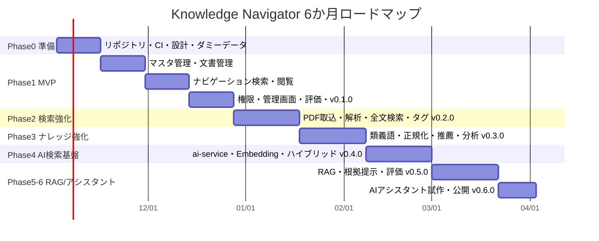

# ROADMAP — 社内規程ナビ（6か月）

> ステータス: Draft v0.1 / 2026-10-20
> 前提: 1人開発、週15〜20時間、2週間スプリント。期間: 2026-11-02 〜 2027-04-30
> 方針: **AIなしで価値が出るMVPを最初の2か月で完成させる**。AIは後半3か月。

---

## 1. 全体像

| 月 | 期間 | フェーズ | マイルストーン | 完了判定 |
|---|---|---|---|---|
| **M1** | 11/02〜11/29 | Phase0 → Phase1前半 | 開発基盤・マスタ/文書CRUD | `docker compose up` でログイン→文書登録→閲覧 |
| **M2** | 11/30〜12/27 | Phase1後半 | **v0.1.0 MVP** | 評価50問 Hit@5 ≥ 70%、全結果で窓口表示、権限テスト全通過 |
| **M3** | 12/28〜1/31 | Phase2 | **v0.2.0** PDF取込 | ダミーPDF10本を取込、条文単位・ページ番号付きで検索 |
| **M4** | 2/01〜2/28 | Phase3 | **v0.3.0** ナレッジ強化 | 評価100問 Hit@5 ≥ 85%、ゼロヒット率 < 10% |
| **M5** | 3/01〜3/28 | Phase4 | **v0.4.0** ハイブリッド検索 | 言い換え質問セットで keyword単体比 +10pt |
| **M6** | 3/29〜4/30 | Phase5 → Phase6試作 | **v0.5.0 RAG / v0.6.0** | 根拠付き回答、引用正確性 ≥ 95%、回答不能時の窓口案内 |

> 年末年始（12/28〜1/4）は稼働半分を想定し、Phase2 を3週間+バッファで計画。

---

## 2. スプリント計画（MVP完成まで詳細）

| Sprint | 期間 | ゴール | 主なIssue |
|---|---|---|---|
| S1 | 11/02〜11/15 | **Phase0: 土台** | リポジトリ作成、ラベル/Projects、compose（PG+pg_bigm）、Spring Boot/Next.js 雛形、CI、Flyway初期スキーマ、ダミー組織・規程の作成、ADR 0001-0004 |
| S2 | 11/16〜11/29 | **マスタと文書** | 認証（デモユーザー）、部署/窓口/カテゴリAPI、文書・版・セクション分割（Markdown見出し/条文）、シード投入、文書一覧/詳細画面 |
| S3 | 11/30〜12/13 | **ナビゲーション検索** | 制度・きっかけ・FAQ・キーワード辞書、`/navigate` API、窓口導出、検索結果画面、ホーム画面（きっかけ） |
| S4 | 12/14〜12/27 | **MVP仕上げ・リリース** | 公開範囲・所管部署権限＋マトリクステスト、管理画面（文書/制度/FAQ/辞書）、検索ログ・フィードバック、評価バッチ＋CI、README/デモGIF、**v0.1.0** |

### Phase2〜6 の概要

| Sprint | 期間 | ゴール |
|---|---|---|
| S5-S6 | 12/28〜1/31 | MinIO、アップロード、PDFBox抽出、条文検出・ページ保持、取込ジョブ、解析結果確認画面、タグ、PDFビューア → **v0.2.0** |
| S7-S8 | 2/01〜2/28 | Sudachi正規化、類義語辞書、ゼロヒット改善ダッシュボード、重みチューニング、推薦（きっかけ関連）、サジェスト、（任意）OpenSearch比較スパイク → **v0.3.0** |
| S9-S10 | 3/01〜3/28 | ai-service雛形、LLM/Embedding抽象化（Ollama/OpenAI/Azure）、PDF解析のPython移管、Embeddingジョブ、pgvector、RRFハイブリッド、類似条文 → **v0.4.0** |
| S11-S12 | 3/29〜4/25 | RAGパイプライン、引用検証、回答不能判定、SSE UI、根拠パネル、RAG評価 → **v0.5.0** |
| S13 | 4/26〜4/30＋ | AIアシスタント試作（確認質問・制度網羅・チェックリスト）、デモ公開、総括記事 → **v0.6.0** |

---

## 3. リスクとバッファ

| リスク | 兆候 | 対応 |
|---|---|---|
| ダミーデータ作成が重い | S1で規程が書き終わらない | 規程は「条文20〜40条×10本」に絞る。厚労省モデル就業規則等を参考に独自に書き起こし（出典明記） |
| 日本語PDF抽出品質 | 段組み・表が崩れる | ダミーPDFは自分で生成するため構造を制御できる。実務課題はDESIGN_REVIEWに記録 |
| ローカルLLMの性能・速度 | 回答が遅い/品質不足 | 小型モデル+OpenAIで比較、デモ動画は品質の高い設定で撮影 |
| スコープ膨張 | Phase6に手が回らない | Phase6は「試作」扱い。v0.5.0（RAG）で一区切りとして成立させる |

---

## 4. 成果物チェックポイント（ポートフォリオ）

| 時点 | 公開物 |
|---|---|
| v0.1.0 | README（アーキテクチャ図・デモGIF）、設計ドキュメント一式、評価結果 |
| v0.2.0 | 「日本語PDFを条文単位で検索可能にする」技術記事 |
| v0.3.0 | 「pg_bigm + Sudachi + 辞書で検索精度を58%→85%にした」記事（評価推移グラフ） |
| v0.4.0 | 「権限フィルタ付きハイブリッド検索を pgvector で」記事 |
| v0.5.0 | 「根拠を必ず出すRAG：引用検証と回答不能判定」記事、デモ動画 |
